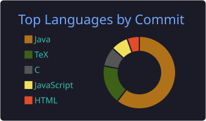
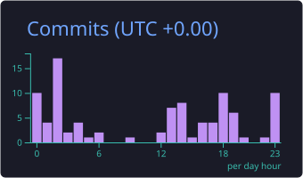

<!-- Imagem de Capa -->

 

<!-- Título Dinâmico em Azul & Preto -->

  Repositório para documentar meus estudos e práticas em desenvolvimento de software, hardware e minhas demandas criativas

<!-- Contato Principal -->

  

<!-- Divisor Visual Azul -->

 

## `01` · Sobre mim

<table width="100%">
  <tr>
    <td width="100%">
      

        Sou uma pessoa curiosa, apaixonada por aprender e explorar diferentes áreas do conhecimento. Gosto de compreender como as coisas funcionam, questionar ideias e buscar conexões entre diferentes campos, especialmente tecnologia e ciência.
      

      

        Atualmente, dedico meus estudos à programação e à engenharia de software, buscando sempre conciliar teoria e prática. Acredito que aprender vai muito além de conhecer ferramentas ou linguagens: envolve compreender conceitos, experimentar, errar e construir conhecimento.
      

      

        Este GitHub é meu espaço para documentar projetos, registrar estudos, compartilhar experiências e acompanhar minha evolução.
      

    </td>
  </tr>
</table>

 

## `02` · Stack & Ferramentas

<table width="100%">
  <tr>
    <td width="100%" align="center">
       
      

        
        
        
        
      

      

        
        
        
        
      

       
      <table>
        <tr>
          <td align="center" width="110">
             
            <b>Java</b>
          </td>
          <td align="center" width="110">
             
            <b>Spring Boot</b>
          </td>
          <td align="center" width="110">
             
            <b>MySQL</b>
          </td>
          <td align="center" width="110">
             
            <b>Python</b>
          </td>
          <td align="center" width="110">
             
            <b>Linux</b>
          </td>
          <td align="center" width="110">
             
            <b>Git</b>
          </td>
          <td align="center" width="110">
             
            <b>GitHub</b>
          </td>
        </tr>
      </table>
       
    </td>
  </tr>
</table>

 

## `03` · Projetos Selecionados

<!-- PROJETO 01 -->
<table width="100%">
  <tr>
    <td width="100%">
      <h3>🖥️ 01 — Servidor Doméstico | Linux & Infraestrutura</h3>
      

        
        
        
        
      

      

        Servidor pessoal baseado em Debian, desenvolvido para integrar serviços de armazenamento, mídia e automações próprias em ambiente conteinerizado, unindo administração de sistemas Linux e desenvolvimento back-end:
      

      <ul>
        <li><b>Nuvem e Mídia:</b> hospedagem privada com Nextcloud para arquivos e Jellyfin para streaming local.</li>
        <li><b>Automação em Python:</b> aplicação desenvolvida para monitoramento e busca de concursos públicos abertos.</li>
        <li><b>Hardening e Contêineres:</b> isolamento de serviços com Podman, regras de firewall e verificações de segurança.</li>
      </ul>
      

        
      

    </td>
  </tr>
</table>

 

## `04` · Métricas & Atividade no GitHub

<table width="100%">
  <tr>
    <td width="100%" align="center">
       
      
      
       
      
        
      
       
    </td>
  </tr>
</table>

 

<!-- Rodapé Visual Azul & Preto -->

  

  

> *"Seja como o promontório, contra o qual as ondas quebram e voltam a quebrar na tempestade; ele se mantém firme até que as águas tumultuosas se rendem à sua volta e vão descansar."*  
> — **Marco Aurélio**

 

