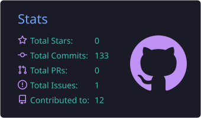

<!-- Imagem de Capa -->

 

<!-- Título Dinâmico em Azul & Preto (Largura ajustada para não cortar letras) -->

  Estudante de Análise e Desenvolvimento de Sistemas na <b>FATEC Ourinhos</b> 
  Estagiário de Suporte Técnico na <b>SEDUC/SP</b>

<!-- Badges Principais (com ícone SVG embutido para o LinkedIn) -->

  
  
  
  

<!-- Divisor Visual Azul -->

 

## `01` · Sobre mim

<table width="100%">
  <tr>
    <td width="100%">
      

        Sou estudante de <b>Análise e Desenvolvimento de Sistemas</b>, apaixonado por desenvolvimento de software, arquitetura de sistemas e engenharia de back-end.
      

      

        Minha principal área de foco se concentra em <b>Back-End com Java e Spring Boot</b>, priorizando código limpo, documentação clara, persistência de dados e construção de aplicações escaláveis.
      

      

        Também exploro projetos práticos com <b>Linux e conteinerização</b>, unindo desenvolvimento e infraestrutura. Minha atuação em suporte técnico fortalece essa base com diagnóstico preciso e resolução de problemas reais.
      

      

        🎯 <b>Objetivo atual:</b> Oportunidade de <b>Estágio ou Desenvolvedor Júnior</b> em Engenharia / Desenvolvimento de Software.
      

    </td>
  </tr>
</table>

 

## `02` · Stack & Ferramentas

<table width="100%">
  <tr>
    <td width="100%" align="center">
       
      

        
        
        
        
      

      

        
        
        
        
      

       
      <table>
        <tr>
          <td align="center" width="110">
             
            <b>Java</b>
          </td>
          <td align="center" width="110">
             
            <b>Spring Boot</b>
          </td>
          <td align="center" width="110">
             
            <b>MySQL</b>
          </td>
          <td align="center" width="110">
             
            <b>Python</b>
          </td>
          <td align="center" width="110">
             
            <b>Linux</b>
          </td>
          <td align="center" width="110">
             
            <b>Git</b>
          </td>
          <td align="center" width="110">
             
            <b>GitHub</b>
          </td>
        </tr>
      </table>
       
    </td>
  </tr>
</table>

 

## `03` · Projetos Selecionados

<!-- PROJETO 01 -->
<table width="100%">
  <tr>
    <td width="100%">
      <h3>🖥️ 01 — Servidor Doméstico | Linux & Infraestrutura</h3>
      

        
        
        
        
      

      

        Servidor pessoal baseado em Debian, desenvolvido para integrar serviços de armazenamento, mídia e automações próprias em ambiente conteinerizado, unindo administração de sistemas Linux e desenvolvimento back-end:
      

      <ul>
        <li><b>Nuvem e Mídia:</b> hospedagem privada com Nextcloud para arquivos e Jellyfin para streaming local.</li>
        <li><b>Automação em Python:</b> aplicação desenvolvida para monitoramento e busca de concursos públicos abertos.</li>
        <li><b>Hardening e Contêineres:</b> isolamento de serviços com Podman, regras de firewall e verificações de segurança.</li>
      </ul>
      
    </td>
  </tr>
</table>

 

<!-- PROJETO 02 -->
<table width="100%">
  <tr>
    <td width="100%">
      <h3>💳 02 — PDV | Sistema de Ponto de Venda</h3>
      

        
        
        
      

      

        Aplicação de gestão comercial projetada para o controle completo de operações de frente de caixa, com foco na implementação de regras de negócio, integridade transacional e organização modular do sistema:
      

      <ul>
        <li><b>Catálogo e Estoque:</b> cadastro estruturado de produtos e controle automatizado de movimentação de estoque.</li>
        <li><b>Operação de Caixa:</b> registro ágil de vendas com rotinas completas de abertura e fechamento de caixa.</li>
        <li><b>Relatórios Gerenciais:</b> consolidação de dados financeiros e indicadores de desempenho de vendas e inventário.</li>
      </ul>
      
    </td>
  </tr>
</table>

 

<!-- PROJETO 03 -->
<table width="100%">
  <tr>
    <td width="100%">
      <h3>🗄️ 03 — CRUD | Java, Spring Boot & Banco de Dados</h3>
      

        
        
        
        
      

      

        Aplicação full-stack de gerenciamento de registros desenvolvida para consolidar boas práticas de arquitetura em camadas, persistência relacional e integração entre back-end e interface web:
      

      <ul>
        <li><b>Operações Completas:</b> implementação estruturada das rotinas de criação, consulta, atualização e exclusão (CRUD).</li>
        <li><b>Arquitetura Back-End:</b> organização em camadas (Controller, Service e Repository) com Spring Boot.</li>
        <li><b>Integração Front-End:</b> consumo de endpoints RESTful por meio de interface reativa construída em React.</li>
      </ul>
      
    </td>
  </tr>
</table>

 

## `04` · Métricas & Atividade no GitHub

<table width="100%">
  <tr>
    <td width="100%" align="center">
       
      
      
       
      
        
      
       
    </td>
  </tr>
</table>

 

## `05` · Formação & Visão

<table width="100%">
  <tr>
    <td width="100%">
      <h3>🎓 Tecnologia em Análise e Desenvolvimento de Sistemas — FATEC Ourinhos</h3>
      

        
      

      

        Busco aprofundar continuamente meus conhecimentos em <b>arquitetura de software, padrões de projeto, bancos de dados relacionais e boas práticas de engenharia</b>. Acredito na solidez dos fundamentos técnicos, no aprendizado contínuo e na colaboração para construir sistemas confiáveis e de fácil manutenção.
      

    </td>
  </tr>
</table>

 

<!-- Rodapé Visual Azul & Preto -->

  

&nbsp;

&nbsp;

  

> *"Seja como o promontório, contra o qual as ondas quebram e voltam a quebrar na tempestade; ele se mantém firme até que as águas tumultuosas se rendem à sua volta e vão descansar."*  
> — **Marco Aurélio**

 

